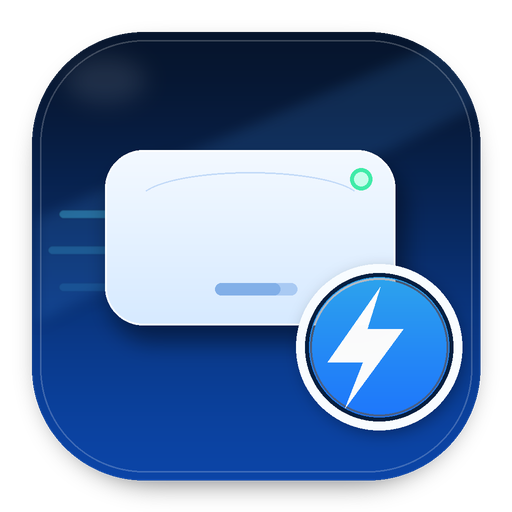

# DriveStream

<p align="center">
  
</p>

<p align="center">
  <strong>Google Drive as a Finder volume, with local SSD caching and a native Mac menu-bar interface.</strong><br>
  SwiftUI · AppKit · Swift 6 · rclone
</p>

DriveStream is an independent, open-source macOS application that mounts Google Drive as a filesystem volume. It combines long-lived directory metadata caching, local write-back caching, byte-range reads, and a small menu-bar control panel. The goal is responsive Finder browsing and practical streaming of large files without downloading an entire cloud library first.

**Apple Silicon M1 and newer are the primary target.** The release configuration builds both `arm64` and `x86_64` slices and targets **macOS 14 or later**. The current development configuration is **1.2.1**, not a claim that a new stable Release or CI run has been published.

The 1.2 work prioritizes a persistent, native Finder workflow and measured performance: bounded Swift/POSIX cache warming, memory-aware resource settings, separate launch-at-login controls, sleep/wake recovery, and conservative pending-write exit checks. See [performance measurements and their limits](<docs/performance.md>). Swift was sufficient for the measured improvements; no Rust rewrite is required by this evidence.

> [!IMPORTANT]
> DriveStream is a cloud filesystem, not a physical SSD, a backup service, or a complete offline synchronization engine. Uncached reads depend on the network and Google. A completed Finder copy can precede completion of the cloud upload. Keep backups and start with disposable test files before using important data.

> [!NOTE]
> The source and local validation results are available now. GitHub Releases and green Actions runs exist only after a maintainer uploads this repository and successfully runs the workflow. The [verification record](<docs/verification.md>) describes what was actually tested; it does not claim a completed Google sign-in or GitHub CI run.

DriveStream is not affiliated with or endorsed by Google, rclone, macFUSE, FUSE-T, or Apple.

## Choose your starting point

| You want to… | Start here |
| --- | --- |
| Install and use the app | [Install](#install) → [First-run setup](#first-run-setup) |
| Connect your Google account | [Google Drive authentication](#google-drive-authentication) |
| Understand offline access or free disk space | [Cache, offline access, and eviction](#cache-offline-access-and-eviction) |
| Keep a Finder shortcut or reduce memory/network use | [Keep in Finder](#keep-in-finder-locations-and-favorites) → [Settings](#settings-reference) → [Measured performance](<docs/performance.md>) |
| Enable encryption | [Client-side encryption](#client-side-encryption) |
| Upload this project to GitHub without local Xcode | [Publish this repository on GitHub](#publish-this-repository-on-github) |
| Build or contribute | [Build from source](#build-from-source) → [Tests and verification](#tests-and-verification) |
| Diagnose a failure | [Troubleshooting](#troubleshooting) |

## Contents

- [Important behavior at a glance](#important-behavior-at-a-glance)
- [Features and scope](#features-and-scope)
- [Requirements and compatibility](#requirements-and-compatibility)
- [Install](#install)
- [First-run setup](#first-run-setup)
- [Google Drive authentication](#google-drive-authentication)
- [Client-side encryption](#client-side-encryption)
- [Daily use and safe uploads](#daily-use-and-safe-uploads)
- [Finder integration and system settings](#finder-integration-and-system-settings)
- [Cache, offline access, and eviction](#cache-offline-access-and-eviction)
- [Settings reference](#settings-reference)
- [Measured performance and resource trade-offs](<docs/performance.md>)
- [Files, permissions, and privacy](#files-permissions-and-privacy)
- [Architecture and reliability](#architecture-and-reliability)
- [Exact rclone mount profile](#exact-rclone-mount-profile)
- [Publish this repository on GitHub](#publish-this-repository-on-github)
- [GitHub Actions and releases](#github-actions-and-releases)
- [Build from source](#build-from-source)
- [Tests and verification](#tests-and-verification)
- [Project layout](#project-layout)
- [Troubleshooting](#troubleshooting)
- [Known limitations and unsupported workflows](#known-limitations-and-unsupported-workflows)
- [Updates, disconnecting, and uninstalling](#updates-disconnecting-and-uninstalling)
- [Contributing and reporting issues](#contributing-and-reporting-issues)
- [License and third-party terms](#license-and-third-party-terms)

## Important behavior at a glance

Read these before mounting a real library:

1. **Operations affect Google Drive.** Creating, editing, renaming, moving, or deleting files through the mounted volume can change the corresponding cloud data. This is not a separate backup copy.
2. **Local copy completion is not cloud completion.** Full VFS caching stages writes on the Mac; rclone uploads them afterward. Wait for pending transfers to finish and verify important files in Google Drive before deleting originals.
3. **“Pin Offline” is best-effort cache warming.** New results record only eligible requested roots whose reads/traversal completed without an affected failure. rclone's cache size and age policy can still evict those bytes; existing markers are historical observations, not current offline-availability certificates.
4. **“Evict Local Copy” and “Free Up Space Now” do not instantly purge file chunks.** They invalidate directory metadata through `vfs/forget`; disk reclamation remains governed by rclone. See [eviction semantics](#what-evict-and-free-up-actually-do).
5. **Encryption does not encrypt the local VFS cache.** Cloud data can be encrypted by `rclone crypt`, while downloaded/staged data on the Mac remains readable locally. The config contains reversibly obscured encryption passwords. Protect it and consider FileVault.
6. **Builds are ad-hoc signed, not notarized.** There is no Developer ID identity or notarization ticket in the default pipeline. Only open a build from a source you trust.
7. **The NFS backend is experimental upstream.** Driver detection does not prove that a particular macFUSE/FSKit mode works on your machine. Test your own applications and files.
8. **5 TB is an example account capacity, not an allocation.** DriveStream does not provide storage or impose a 5 TB limit. It uses the capacity reported for your Google account when that information is available.

## Features and scope

### What DriveStream provides

| Feature | How it works | Practical benefit |
| --- | --- | --- |
| Finder volume | Managed `rclone mount` or `rclone nfsmount` process | Browse cloud files using Finder and applications that support the resulting filesystem |
| Directory metadata cache | `--dir-cache-time 9999h`, `--poll-interval 15s`, `--attr-timeout 1h` | Reduces repeated remote directory lookups; cached listings can be much quicker |
| Background metadata warm-up | Asynchronous recursive `vfs/refresh` followed by `job/status` polling | Warms directory entries without making the initial HTTP request wait for the whole tree |
| Local write-back cache | `--vfs-cache-mode full`, `--vfs-write-back 5s` | Stages writes locally before uploading them |
| Streaming reads | 16M initial chunks, 256M chunk limit, 64M read-ahead | Fetches file ranges as needed instead of requiring a complete library download |
| Configurable cache policy | Default `10G` maximum size and `1h` maximum age | Lets you balance local SSD use against reread/download costs |
| Google quota display | `operations/about` and an explicit-byte capacity argument | Shows the reported account capacity rather than confusing it with the Mac's SSD size |
| Native controls | SwiftUI menu-bar window and AppKit integration | Mount, refresh, inspect transfers, open Finder, and manage settings |
| Finder Services | Pin and eviction request handlers | Perform cache-related actions on selected paths inside the mounted volume |
| Custom OAuth | Personal Google Cloud Client ID and Client Secret | Reduces shared-client quota pressure and avoids depending on retired shared credentials |
| Optional crypt layer | `rclone crypt` with Keychain password copies | Encrypts new cloud content and filenames through the encrypted view |
| Safer error recovery | Friendly summaries, redacted details, bounded retries, retained mount ownership | Keeps failures visible without blindly replaying operations or losing track of a remaining mount |
| Bounded cache warming | Swift TaskGroup workers, dedicated blocking-I/O queues, reusable 4 MiB POSIX buffers | Streams selected trees without a whole-library file array; bounded snapshots avoid UI task floods |
| Resource and bandwidth controls | Automatic/responsive/lower-memory profiles, 1–4 file-reader override, independent upload/download limits | Makes the trade-off explicit, with a conservative default for an 8 GB M1 |
| Startup and Finder continuity | User-toggled `SMAppService` login item, mount-on-launch, Favorites help, preserved healthy mounts | Keeps a familiar entry point without editing private Finder databases or faking detached Locations |
| Pending-write visibility | Fresh queue/stat checks plus read-only dirty-cache inspection and a best-effort recovery ledger | Warns before ordinary shutdown when required writes remain or status is unknown; not a cloud durability guarantee |

### What it is not

DriveStream is not the official Google Drive desktop client. It is not a macOS File Provider extension and does not supply Finder's native cloud placeholder/sync-status system. It does not maintain a second authoritative local copy of every cloud file, resolve multi-editor conflicts, or provide backup/version-retention guarantees.

The built-in interface manages one Google Drive account/mount configuration. Advanced rclone features such as service accounts, Shared Drive selection, arbitrary extra mount flags, bandwidth schedules, and multiple account profiles are not exposed as complete first-run workflows.

## Requirements and compatibility

### To install and run

| Requirement | Details |
| --- | --- |
| macOS | Deployment target is macOS 14.0 or later |
| Mac architecture | Native Apple Silicon `arm64`; release binaries also include Intel `x86_64` |
| Google account | Drive access and sufficient account permissions/quota |
| Network | Required for OAuth, the first helper download, uncached reads, and uploads |
| Local storage | Enough free space for the configured cache and pending writes; the cloud quota does not create free local SSD space |
| Optional filesystem driver | macFUSE or FUSE-T for the FUSE route; otherwise the app can try built-in NFS |
| Optional administrator approval | Needed if you choose to install/approve a filesystem driver, not for creating Google OAuth credentials |

**Xcode, Homebrew, and a Terminal workflow are not required to use a published app build.** Developers need additional tools, described under [Build from source](#build-from-source).

### Apple Silicon and Intel

- M1 and all newer M-series Macs use the native `arm64` application slice.
- The helper download checks the hardware through `hw.optional.arm64`, so an Apple Silicon Mac still receives native arm64 rclone if the app itself was launched under Rosetta.
- Intel Macs receive the official `amd64` helper.
- CI rejects a release if either application slice is absent.
- Slice presence and deployment-target checks are not the same as runtime testing on every supported Mac. See [tests and verification](#tests-and-verification) for the recorded hardware/runtime coverage.

### Backend selection

| Preference or condition | Attempt order |
| --- | --- |
| Automatic | Installed macFUSE, installed FUSE-T, then built-in NFS |
| macFUSE preference | Available FUSE candidates, then NFS fallback |
| Built-in NFS | NFS only |

Detection checks the installed filesystem bundles. It does **not** validate every installed driver version, approval state, or FSKit capability. A detected driver can still fail to mount.

macFUSE may offer a user-space FSKit backend for supported macOS/filesystem combinations. DriveStream does not explicitly select or verify FSKit merely because its interface labels a backend “macFUSE / FSKit.” Other configurations may use a kernel backend and require additional approval or Recovery Mode steps. Follow the [current macFUSE documentation](https://macfuse.github.io/) rather than assuming one approval process fits every macOS version.

The built-in NFS route avoids installing a third-party FUSE driver, but remains an experimental rclone feature and presents network-filesystem semantics to macOS. The inspected official rclone v1.75.2 `nfsmount` implementation uses a **go-nfs NFSv3 server**, not NFSv4. A local server or a Finder Locations entry does not change that protocol into APFS/local-disk semantics; recheck upstream behavior for a different helper version.

## Install

### From a GitHub Release

After the maintainer publishes a successful tagged build:

1. Open this repository's **Releases** page.
2. Download the installer or app ZIP, plus the checksum file from the **same release**.
3. Verify the download if you will use it with important data.
4. Open the DMG and drag the app into **Applications**, or extract the app ZIP and move the app there.
5. Launch DriveStream from Applications.
6. Complete the [first-run setup](#first-run-setup).

Release assets are named:

```text
DriveStream.dmg
DriveStream-macOS.zip
SHA256SUMS.txt
```

A source-code ZIP downloaded using GitHub's **Code → Download ZIP** is **not** an application installer.

If no Release exists yet, use the workflow artifact from a successful Actions run or follow [the GitHub publishing guide](#publish-this-repository-on-github). Publishing source alone does not create release assets.

### From a workflow artifact

1. Open **Actions → Build & Release** and select a successful run.
2. Download the artifact named **DriveStream-macOS**. GitHub may require you to sign in.
3. Extract that outer artifact archive.
4. Inside it, use the DMG or the inner app ZIP listed above.

Workflow artifacts are retained for **30 days**. Tagged Release assets are the intended public download location; artifact expiry does not provide a permanent release channel.

### Verify checksums

Place the downloaded assets and their checksum file in the same directory. From that directory, run:

```bash
shasum -a 256 -c SHA256SUMS.txt
```

The entries for both assets should report `OK`. If you downloaded only one asset, the command can also report that the other file is missing; that is different from a checksum mismatch on the file you actually downloaded.

A checksum checks integrity relative to the manifest. It does not replace trust in the account publishing both files. A mismatch on the downloaded asset is a reason to stop, discard that download, and obtain a fresh trusted copy—not to skip verification.

### Gatekeeper and signing

The default build is **ad-hoc signed and not notarized**. macOS may block its first launch.

- If available, use Finder's **Open** action or **System Settings → Privacy & Security → Open Anyway** after verifying the source.
- On a trusted build, the documented quarantine-removal command is:

  ```bash
  xattr -cr /Applications/DriveStream.app
  ```

Only do this when you understand that it removes quarantine checks for that app. Do not use it to bypass a warning for an unknown download.

To verify the installed bundle's signature integrity:

```bash
codesign --verify --deep --strict --verbose=2 /Applications/DriveStream.app
```

An intact ad-hoc signature still does not identify an Apple-verified publisher. Organizations with restrictive execution policies may require a separately Developer-ID-signed and notarized build.

## First-run setup

The app appears as a drive icon in the menu bar, not as a persistent Dock icon. Clicking it opens the control panel. The Setup Assistant has four stages:

### 1. Welcome: prepare rclone

DriveStream downloads the official static rclone archive when needed. It does not use Homebrew's rclone formula or require a system-wide rclone installation.

The app:

1. Detects the Mac's native architecture.
2. Reads the official release version and versioned checksum manifest.
3. Downloads the current official arm64 or amd64 archive over HTTPS.
4. Verifies the exact archive filename's SHA-256 before executing its contents.
5. Checks ZIP entries for unsafe paths, symlinks, duplicates, and unsupported archive layouts.
6. Extracts the expected executable, checks its version/mount support, clears quarantine, and installs it with executable permissions.

The installed helper is private to DriveStream:

```text
~/Library/Application Support/DriveStream/bin/rclone
```

The first setup needs internet access. A bad download or an upstream release changing between version lookup and download fails verification instead of silently installing unverified bytes. Retry the preparation step if that happens.

### 2. Account: connect Google Drive

Choose a personal Google OAuth client or the compatibility option using rclone's default credentials. Then sign in through your browser. The app verifies access using rclone and displays available account/quota information.

For new installations, a **personal Client ID is strongly recommended**. See [the authentication guide](#google-drive-authentication), including the warning about shared-client retirement.

### 3. Privacy: optionally enable crypt

Leave encryption off to view the Drive in its normal format. Enable it only after reading [Client-side encryption](#client-side-encryption), especially if you already have plaintext files or previously encrypted content.

The app requires at least eight characters for a new primary password and for a non-empty optional salt password. A long, unique passphrase is a better choice than the minimum length.

### 4. Mount: finish setup

Review the account, volume name, backend, cache policy, and mount location. Finish without mounting or choose to mount automatically.

The normal mount path is:

```text
~/DriveStreamVolumes/Google Drive
```

A different volume name changes the final folder component. If you select `/Volumes` and the process can create the required directory there, the path is:

```text
/Volumes/Google Drive
```

If `/Volumes` is not writable, the automatic location falls back to the home-folder location. A custom mount path must be an appropriate absolute, empty, non-symlink folder; protected system locations and the filesystem root are rejected.

Do not put ordinary local files into the mount folder while the volume is unmounted. A non-empty mount folder can prevent the next mount, and a mounted filesystem would otherwise hide the directory's local contents.

## Google Drive authentication

### Which sign-in method should I use?

| Method | Setup | Trade-off |
| --- | --- | --- |
| Personal OAuth client | Create a Google Cloud Desktop app Client ID and Client Secret | Recommended for new setups; uses your own client quota rather than relying on a shared client |
| rclone default | No custom fields | Retained as a compatibility fallback, but availability depends on upstream rclone and Google's policy |

A personal client reduces shared-client quota pressure during **4K video scrubbing and heavy Finder browsing**. It cannot remove per-account upload/download limits, guarantee an unthrottled API, or improve a slow internet connection by itself.

> [!WARNING]
> rclone's [Google Drive documentation](https://rclone.org/drive/#making-your-own-client-id) warns that its shared Client ID is being retired during 2026. The default option being present in DriveStream's UI is not a guarantee that shared credentials will continue to authorize. If default sign-in fails, create a personal client instead of repeatedly retrying it.

### Create a personal Google Cloud client

Google occasionally changes the Console's navigation labels; use the linked pages and the underlying task if the interface looks different.

1. Open the [Google Cloud Console](https://console.cloud.google.com/) and create or select a project you control.
2. Open [Google Drive API](https://console.cloud.google.com/apis/library/drive.googleapis.com) and enable it for that project.
3. Configure the Google Auth Platform / OAuth consent screen:
   - Choose an appropriate audience. External is common for a personal setup; Internal is available only for eligible Workspace organizations.
   - Supply the required application/support details.
   - If the project is in **Testing**, add the Google account you will sign in with as a test user.
4. Open [Credentials](https://console.cloud.google.com/apis/credentials), create an **OAuth client ID**, and select **Desktop app** as the application type.
5. Copy the resulting **Client ID** and **Client Secret** into DriveStream's Account step.
6. Select **Personal OAuth client** and click **Sign in with Google**.
7. Complete Google's browser consent flow using the intended account.
8. Return to DriveStream and wait for connection verification before continuing.

Do not choose a Web application client simply because a loopback URL is involved. The flow is a desktop-app OAuth flow.

Google Testing status, consent requirements, verification policy, and Workspace administrator restrictions can affect whether tokens are granted and how long they remain valid. Review [Google's OAuth documentation](https://developers.google.com/identity/protocols/oauth2) if you are unexpectedly prompted to reconnect or the account is blocked by an administrator.

### OAuth permissions and secret storage

DriveStream configures rclone's **`drive` scope**. That is broad access to Drive files, including reading, writing, renaming, and deleting; it is **not** the limited `drive.file` scope. Only authorize an app build you trust with that access. See [rclone's scope definitions](https://rclone.org/drive/#scopes).

DriveStream does not ask for your Google account password. The browser handles Google's login. The app receives authorization tokens and stores them in its private config.

- Client ID: stored as a non-secret preference and in the rclone remote.
- Client Secret: copied to the login Keychain; rclone also needs a copy in its private config to refresh tokens.
- OAuth token/refresh token: stored in the private rclone config with `0600` permissions.

These are **runtime credentials**, not GitHub Actions secrets. The build/release workflow does not need a real Google account, OAuth token, Client Secret, or encryption password.

### The loopback receiver

During sign-in, rclone listens locally at:

```text
http://127.0.0.1:53682/
```

That temporary OAuth listener is separate from the dynamically assigned RC port used by the mounted filesystem. A firewall, VPN, another authorization process, or browser restriction that blocks the loopback receiver can prevent sign-in.

Authorization has a bounded wait of approximately five minutes. Closing Setup using **Set Up Later** cancels DriveStream's pending Google connection task rather than leaving its helper indefinitely active.

### Reconnect or change credentials

Use **Settings → Account → Reconnect**, or open the Setup Assistant to change the sign-in method.

- A mounted/retained session must be detached before the app rewrites its config.
- On a successful reconnect, an originally mounted session is remounted.
- A blank personal Client Secret can reuse the Keychain copy only if the Client ID still matches.
- A different Client ID needs that client's matching secret.
- Changing personal/default mode requires reconnecting before the Account step can continue.

If detachment fails, close applications using the volume and retry. Do not work around the guard by editing a live config file.

## Client-side encryption

### What the toggle changes

The optional **Client-Side End-to-End Encryption (`rclone crypt`)** workflow layers a crypt remote over the normal Google Drive remote. rclone, not DriveStream's UI, implements the cryptographic format.

The configured crypt view uses:

- Standard filename encryption.
- Directory-name encryption.
- A primary encryption password.
- An optional second password used as the crypt salt password.

New file data written through this view is encrypted before reaching Google. The underlying normal Drive remote remains configured for account/quota operations. See [rclone crypt documentation](https://rclone.org/crypt/) for the format, security model, and metadata limitations.

### Existing plaintext files are not automatically encrypted

Turning crypt on is **not a migration command**. It does not traverse your existing library and convert it in place.

An existing plaintext Drive and a crypt view are different views of the stored objects. Plaintext files can become invisible or unreadable through the encrypted view. Use crypt deliberately for new encrypted data or a compatible existing crypt remote.

For an important existing library, plan and verify a separate migration using the appropriate rclone tools and backups. Do not experiment by toggling encryption and moving/deleting your only copy of a library.

### Existing encrypted files require the exact keys

Changing either password does not re-encrypt old objects. It changes the keys used to interpret them, which can make previously encrypted data unreadable.

- Preserve exact password and salt whitespace.
- Keep a secure independent recovery copy of both values.
- A missing Keychain copy does not necessarily mean the config lacks the existing obscured value.
- In Setup, a blank primary password for an already configured crypt remote keeps that remote unchanged. Editing only the salt field while leaving the primary blank is not a supported key-change workflow.
- Re-entering a password to restore Keychain storage must use the exact existing value, not a new guess.
- If you supply a primary password while leaving the salt field blank, the rewrite removes a previously configured salt. That can change the derived keys even if the primary password is correct.

For an existing crypt remote, the safest way to retain the current configuration is to leave **both** fields blank. To rewrite/restore its credentials, supply the exact original primary password **and** the original optional salt when one was used. Salt-only edits are not applied.

The Setup Assistant is not a general importer for every possible crypt layout. Existing compatible filename/directory encryption modes are retained; defaults apply to absent options. Its shallow listing check is not proof that every encrypted object can be decrypted.

The 1.2 implementation verifies a private candidate before publishing the Keychain/config changes. It snapshots previous credentials and exact config bytes, checks for an intervening config change, and attempts restoration if publication fails. A Keychain operation and a filesystem rename are **not a distributed atomic transaction**: rollback can fail, a crash can interrupt publication, and a listing success does not validate the entire library. Preserve independent exact keys and a private configuration backup before changes.

Password obscuration uses the compatible CommonCrypto primitive directly in Swift, preserving UTF-8 bytes—including whitespace and line breaks—without putting plaintext or obscured crypt keys in helper arguments. This removes the old command-line fallback; the resulting config values remain reversible, not encrypted storage.

There is no password-reset service that can recover encrypted files without their keys.

### Keychain does not make the config or cache safe to publish

[KeychainHelper](<Sources/Services/KeychainHelper.swift>) stores password copies in the macOS login Keychain. rclone's config still contains **reversibly obscured** crypt passwords. Obscuring is not encryption of the configuration file.

The VFS cache can contain **decrypted downloads and staged plaintext writes**. FileVault can protect the Mac's local disk at rest; it is independent of cloud-side crypt encryption.

Never publish the private config, local cache, Keychain exports, or real passwords in a repository, release, screenshot, support archive, or public issue.

## Daily use and safe uploads

### Mount and browse

1. Launch DriveStream.
2. Click the menu-bar drive icon and choose **Mount** if it has not mounted automatically.
3. Wait for mount readiness. The app verifies the authenticated helper PID and the filesystem attachment.
4. Choose **Open in Finder**.
5. Enable the relevant external-disk/network-volume items in **Finder → Settings → Sidebar** if the volume is not visible under Locations.

The mount is a real filesystem attachment, but Finder can classify an NFS-backed attachment as a network/server volume. A home-folder mount path does not make it a local APFS SSD.

### Let directory warm-up finish

After mounting, the app sends an asynchronous recursive refresh and displays:

```text
Indexing directory tree in RAM...
```

This warms metadata, not the full contents of every cloud file. A very large number of directories/files can take minutes and consume substantial RAM even when the byte capacity of the account is unchanged.

The volume can be used during warm-up; uncached listings may still need remote requests. Use **Refresh** to explicitly submit another refresh when you need it. RAM directory state is recreated after the rclone process exits; the disk cache is a separate layer.

### Understand writes before relying on them

A write generally follows this sequence:

```text
Application/Finder → local VFS cache → write-back delay → Google Drive upload
```

The fixed write-back delay is five seconds of inactivity before eligible writes are queued for upload. Large uploads, throttling, a full local disk, permission failures, or a lost network can make remote completion take much longer.

For important uploads:

1. Keep enough free SSD space for the working set and pending writes.
2. Leave DriveStream running and maintain the network connection.
3. Watch active transfers and queued-upload information.
4. Check for errors and stale telemetry; an empty/stale display alone is not proof that data reached Google.
5. Verify critical files in Google Drive before deleting the source copy or clearing app data.

Ordinary Unmount/Quit first requests fresh authenticated queue/core/VFS evidence and inspects the helper-reported private cache metadata for dirty files, including modified writes not yet queued. Missing, stale, malformed, unsupported or incomplete evidence is **unknown**, not “all uploaded.” Dirty/queued/error states and unknown write status require keeping the app running or an explicit interrupted-exit decision.

An omitted optional `fatalError` diagnostic does not by itself make a complete idle queue unknown. The separate dirty-cache inspection and non-forced OS unmount remain required. Metadata scanning ignores only verified Finder DS_Store/AppleDouble binary sidecars, not every hidden filename; valid JSON for hidden remote files is still examined for pending writes. Reads use 4 KiB chunks, retaining a 256 KiB total per-file bound because legitimate sparse range metadata can exceed one page.

After the ordinary write check passes, DriveStream asks macOS for a **normal, non-forced unmount before stopping a running owned helper**. If macOS refuses because files are open, the helper/session remain available so you can close writers and retry. Shutdown can subsequently use an interrupt, a twelve-second wait, SIGTERM with four seconds, and SIGKILL with three seconds, followed by owned-attachment cleanup. These are per-stage waits, not a guaranteed total shutdown deadline.

**Quit Anyway** deliberately permits an interrupted exit; it is not a flush/upload-success command. Cache files are retained, but cloud data may remain incomplete and recovery can require a later compatible mount. A small private recovery ledger preserves observed pending/error warnings across restarts on a best-effort basis, not as a cloud-acknowledgement journal. Storage failure, abrupt process/system termination, version-dependent metadata and writers changing after a check remain limitations.

None of this is a promise to wait until every cloud upload succeeds or proof that Google durably acknowledged all writes. Close applications writing to the volume, verify important remote copies independently, and never delete cache/config while needed pending data may remain.

### Remote edits, deletions, and shortcuts

Edits through the mounted volume can change the cloud objects. Changes made elsewhere can take time to appear because of metadata/attribute caching; use Refresh and allow for Drive/rclone polling.

rclone's Drive backend normally uses Drive Trash for ordinary deletions, but that is not a backup guarantee. Behavior can depend on backend settings, permissions, object type, and Google policy.

**Be especially careful with Google Drive shortcuts.** rclone can dereference them into the linked content, and deleting inside a shortcut folder through a mount can affect that content. Read [rclone's shortcut behavior](https://rclone.org/drive/#shortcuts) before performing destructive operations in shared/shortcut folders.

Google-native documents, exports, duplicate names, file locking, metadata, and application-specific save behavior follow the rclone/backend/filesystem combination. This is not an offline Google Docs editing client.

### Launch at login is a separate choice

**Mount automatically** means mount when the app launches; it is separate from **Settings → General → Launch at login**. The login toggle uses the supported `SMAppService.mainApp` register/unregister API only after your choice. Initialization reads its status; it does not silently register a login item. If macOS requires approval, use **Approve in Login Items** and review the system setting.

Enable both choices if you want the app to start and attempt a mount after login. A login item is not a guarantee that Google, the network, credentials or the filesystem driver will be ready. Changing Launch at login is an immediate system registration action, not just a draft preference waiting for Save.

### Sleep, wake and network changes

The app observes `NWPathMonitor` and macOS sleep/wake notifications. Starting monitoring after a stop creates a fresh network monitor; session IDs reject queued callbacks from earlier network and workspace observers. Losing network reachability does not deliberately unmount a healthy cached session; the interface can show **Offline · cached volume**. Sleep stops telemetry and retains the local server/cache attachment rather than claiming there is time to flush an entire upload queue.

On wake, the app checks the authenticated helper PID before resuming telemetry. With **Restore after wake** enabled, a previously active but stopped session can be remounted when ownership has been safely cleaned up and a network path is available. A running but unhealthy helper is kept visible with a warning, not blindly killed/replaced. Network changes request local telemetry recovery; a satisfied path is not proof of Google reachability, and local RC polling may continue while the cloud is offline.

These are configured recovery behaviors, not a tested promise of uninterrupted Finder access under every sleep, VPN, server or driver failure. Cached bytes and metadata can still be absent or evicted.

### Unmount or Quit safely

Close editors and other applications using mounted files, then choose **Unmount** or **Quit**.

- DriveStream retains ownership of a failed remaining session rather than pretending it detached.
- The recovery action becomes **Retry Unmount**.
- Config changes and helper replacement are blocked while a retained session remains.
- Pending/dirty/error/unknown write evidence blocks ordinary Unmount/Quit; **Keep Running** is the safest choice when uploads matter.
- **Quit Anyway** is an explicit acceptance of interrupted writes, not deletion of the cache or proof of remote completion.
- If a Quit attempt cannot detach the owned volume, the app stays open and explains that files/apps need closing.

Avoid using Force Quit as your normal workflow. If the system becomes unresponsive, preserve the cache and investigate recovery before removing app data.

## Finder integration and system settings

### Keep in Finder: Locations and Favorites

Choose **Keep in Finder** from the menu or General settings to open the native guide. Finder owns the sidebar; DriveStream does not edit its private sidebar databases or silently inject a Favorites item.

1. While mounted, enable the relevant external-volume/connected-server items in **Finder → Settings → Sidebar** so Finder can show the attachment under **Locations**.
2. Use the guide's **Open Mount Folder**, then drag that folder into **Favorites once** for a persistent user-managed shortcut.
3. Enable **Launch at login** and **Mount automatically** if you want it mounted again after login.

**Locations means attached volumes; Favorites means saved shortcuts.** A Favorites entry can remain after detachment, but its empty mount directory is not available cloud content or a fake mounted SSD. Never put ordinary local files into that directory while detached. A changed mount path needs the shortcut updated by you.

Preserving a healthy attachment through sleep/network loss improves continuity; it cannot turn missing cached content into offline data. This is a supported Finder workflow, not a File Provider placeholder/sync-badge implementation.

### Finder Services

After the installed app has run and registered its provider, Finder can expose these under its **Services** menu:

- **DriveStream: Pin Offline (Keep on Mac)**
- **DriveStream: Evict Local Copy (Free Up Mac Space)**

Select files/folders **inside the mounted volume**, not the volume root or an unrelated local path. The controller resolves and validates selected paths before acting.

Service registration uses [the plist declarations](<Sources/Info.plist>), `NSApp.servicesProvider`, `NSUpdateDynamicServices()`, and:

```text
/System/Library/CoreServices/pbs -update
```

If the services do not appear:

1. Launch the installed app at least once.
2. Use **Settings → Advanced → Refresh Finder Services**.
3. Check **System Settings → Keyboard → Keyboard Shortcuts → Services**.
4. Restart Finder or log out/in if macOS retains an older service cache.

The app shows a small service feedback panel; it does not require Notification Center permissions just to report a pin/eviction result.

### Global Finder preferences

Some integration changes apply to **Finder as a whole**, not just the DriveStream volume:

| Domain | Keys affected |
| --- | --- |
| `com.apple.desktopservices` | `DSDontWriteNetworkStores` |
| `com.apple.finder` | `ShowSidebar`, `ShowStatusBar`, `ShowPathbar` |
| `com.apple.finder` | `ShowHardDrivesOnDesktop`, `ShowExternalHardDrivesOnDesktop`, `ShowRemovableMediaOnDesktop`, `ShowMountedServersOnDesktop` |

The initial integration setup can run on the **first app launch, before you mount a Drive**. These are account-wide Finder preferences, not settings scoped to DriveStream. The Desktop toggle can therefore affect other local, external, removable, and server volumes. DriveStream does not record and automatically restore the original global values on uninstall.

Use **Apply Finder Preferences** to reapply its current choices. **Restart Finder** closes/relaunches Finder and can close its open windows, so the app asks for confirmation in Settings.

### Spotlight and volume identity

When enabled, Spotlight suppression attempts to create this marker at the mounted root:

```text
.metadata_never_index
```

Turning suppression off does not automatically remove a marker that already exists. If you deliberately re-enable indexing, consider the cost of crawling a large cloud library and manage the existing marker separately.

The app also attempts to install:

```text
.VolumeIcon.icns
```

It prefers the external-drive icon available on the user's macOS installation, with a bundled DriveStream icon as fallback, and leaves an existing destination icon in place. These hidden root files can be stored through the remote filesystem.

Custom-icon FinderInfo writes are best-effort. NFS and metadata-suppression settings can reject them; Finder may show a generic network-volume icon even though mounting worked.

## Cache, offline access, and eviction

### Separate the four layers

| Layer | Purpose | Important property |
| --- | --- | --- |
| RAM directory metadata | Faster listing/lookups | Rebuilt when the helper restarts; not the file contents |
| Local VFS disk cache | Downloaded ranges and staged writes | Sparse/policy-managed and potentially sensitive; not an independent full mirror |
| DriveStream pin preferences | Records requested offline roots | Intent/UI markers, not an rclone exemption from eviction |
| Google Drive | Remote objects | Changes and completed uploads are subject to Google account/Drive behavior |

The default cache policy is `10G` size and `1h` age. rclone size suffixes here represent binary units: `10G` is approximately **10 GiB**, not a reservation of 10 GB in Google Drive.

The size cap is not an instantaneous hard ceiling. Open files, queued writes, cache-cleaner timing, and a large working set can exceed it. Cache age is based on rclone's access/cleanup policy, not an exact expiry countdown from the moment you clicked Pin. The fixed cleaner interval is ten seconds, but that does not guarantee every block becomes eligible to evict at the next tick.

Cache statistics come from rclone. Sparse/chunk accounting and logical file sizes can differ from what Finder or a simple size sum shows for the underlying cache files. The cache meter is not the total size of Application Support and does not reserve a separate protected area for pin requests.

The cloud meter is the last quota reported for the underlying Drive/account, not just the selected folder or encrypted view; account storage can also be shared with other Google products. Capacity is supplied to the mount only when a positive total is available. Google often states capacities in decimal units, while the app's formatter uses 1024-based scaling with familiar unit labels, so a decimal 5 TB quota need not appear as exactly `5.0 TB` in every display.

### What Pin Offline does

The pin service streams eligible regular files through the mounted VFS using bounded Swift workers and a reusable 4 MiB POSIX read buffer per worker. The resource policy normally selects two readers on an 8 GB Mac, four on the larger-memory/responsive profile, or an explicit 1–4 override. Traversal is incremental; it does not build a whole-library file list or allocate a new Data object per chunk.

Ordinary hidden files are included; known Apple metadata is skipped. Descriptor-relative no-follow opens reject symlink roots/intermediate components and skip symlink descendants. Overlapping selections are read once. Progress is serialized and throttled to at most five periodic snapshots per second plus start/finish, rather than scheduling one UI update per small file.

Read, path-validation and directory-enumeration failures are reported through failure counts; a new result adds markers only for fully read eligible requested roots unaffected by such failures. Successful nested/sibling selections can still complete when another selection fails. The current failure count covers failure events, not necessarily distinct failed regular files; it is not a detailed per-path error inventory. Byte counts include bytes read before a file later failed.

It does **not**:

- Keep an independent copy outside rclone's cache.
- Protect a path from rclone's size/age eviction policy.
- Keep a completed read snapshot current after files change, or preserve every previously read byte until you need it.
- Provide a verified offline manifest or an operating-system pin attribute.
- Guarantee that uncached metadata remains available without a network.

A newly failed/partially read requested root is not marked complete by that operation. Existing markers nevertheless remain historical observations and are not continually revalidated. Pinning does not automatically warm newly added or externally changed descendants. Review failure counts and verify the actual working set before going offline.

Cancellation stops new work, checks between chunks and joins the workers so handles/buffers are cleaned up before the pin call returns. An already-blocked kernel filesystem read cannot reliably be interrupted by closing its descriptor from another thread; cancellation can await that filesystem response. Blocking file I/O runs outside the MainActor/Swift cooperative executor, but a slow backend is still a slow backend. See the [offline test coverage and measured benchmark](<docs/performance.md>).

For important offline work, keep the cap comfortably above the working set, avoid an age shorter than your intended offline period, and test access while disconnected. For a durable offline copy, copy the needed files to a normal local folder and verify that separate copy; do not rely solely on a pin marker.

### What Evict and Free Up actually do

The per-path service submits an authenticated `vfs/forget` request and removes the matching DriveStream pin marker on success. The whole-volume **Free Up Space Now** control submits a whole-VFS forget request and refreshes cache information; it does not silently remove every recorded pin marker.

**`vfs/forget` invalidates directory metadata. It does not directly delete cached file chunks.** Disk reclamation happens separately under rclone's cache policy. A successful request does not imply that gigabytes disappeared from the SSD immediately.

DriveStream deliberately does not remove live sparse files from the VFS data/metadata directories. Those files can be in use by open reads or pending uploads. Deleting them behind the helper can damage data or lose queued writes.

The commonly suggested `options/set` trick that changes global `CacheMaxSize` is not used as a claimed live purge: a running mount uses copied VFS options, so changing global defaults is not a supported per-file cache-deletion mechanism. The implementation and limits are described in the [RC documentation](https://rclone.org/rc/).

If you need less local use, close files, let writes finish, and adjust the cache size/age in Settings. Do not remove the cache manually until the app/helper is stopped and you have confirmed that no required pending data remains.

## Settings reference

Settings has **General**, **Performance**, **Account**, and **Advanced** tabs. Saving applicable mount settings restarts a mounted session so the new fixed profile can take effect. If teardown fails, its live path/ownership is retained instead of being overwritten by the new configuration.

| Setting | Default | Constraints or effect |
| --- | --- | --- |
| Volume name | `Google Drive` | Non-empty, up to 64 characters; path separators such as `/` and `:` are rejected |
| Mount location | Home folder | `/Volumes` is used only when permitted; otherwise falls back |
| Custom path | Empty | Absolute, empty, non-symlink mount folder; system/protected/root paths are rejected |
| Filesystem backend | Automatic | FUSE candidates then NFS; NFS preference restricts attempts to NFS |
| Cache maximum size | `10G` | At least 512 MiB, at most 10 TiB; examples include `512M`, `10G`, `25G` |
| Cache maximum age | `1h` | At least one minute and at most 30 days; single-unit values such as `30m`, `1h`, `1d` |
| Mount on app launch | On | Attempts mounting when the app starts; separate from login registration |
| Launch at login | System registration status | User-toggled `SMAppService`; status-only initialization, approval may be required |
| Restore after wake | On | Retains healthy mounts and can recover a previously stopped session when safe/available |
| Resource policy | Automatic | Below 16 GiB RAM: 2 pin readers, 4 transfers, 16M upload chunk/buffer; otherwise responsive-sized profile |
| Parallel file readers | Automatic (`0`) | Policy-selected 2 or 4; explicit override 1–4; does not control all rclone/open-file memory |
| Upload/download limits | `0` / `0` | Separate binary MiB/s limits, each 0–10000; zero means unlimited |
| Suppress Spotlight | On | Attempts to create the marker; does not automatically remove an existing one when disabled |
| Show drive on Desktop | On | Changes global Finder volume-icon preferences |
| OAuth method | Default option initially available | Personal client strongly recommended; manage changes through Setup/reconnect |
| Encryption | Off | Manage through Setup; not an automatic migration/rekey tool |

**Lower memory use** selects the conservative profile regardless of RAM. **Maximum responsiveness** selects 4 pin readers, 8 transfers, 64M Drive upload chunks and 32M rclone buffers regardless of RAM; it can use more memory/CPU without being faster for every workload. Pin's reusable 4 MiB buffers are separate from rclone's per-open-file/cache/upload allocations. The measured warm-local small-file fixture was faster with one reader than two, so “more parallel” is not a universal speed setting.

Bandwidth is passed to rclone as upload:download with explicit `M` suffixes; for example, 10 MiB/s upload and unlimited download becomes `--bwlimit 10M:off`. Both zero omit the flag. This is a static mount profile, not a scheduling interface, and changes take effect on a restarted session.

The app exposes these resource/cache/bandwidth controls, not arbitrary mount flags. Changing fixed profile behavior in source requires tests and documentation updates. See [the performance guide](<docs/performance.md>) for measurements, settings and limits.

### Menu-bar measurements

| Display | What it means |
| --- | --- |
| Google storage meter | Last available account quota from rclone `operations/about`; not the Mac's free disk space |
| Local cache meter | rclone-reported VFS cache use against your configured limit |
| Read | An estimate based on active transfer speeds/cache growth and smoothing; not an exact kernel disk-read counter |
| Write | Background upload/write-back throughput, not a measurement of how fast the SSD accepted an earlier Finder copy |
| Streams | Derived from VFS `inUse` and transfer information; not a precise OS-level count of open editor/video handles |
| Active transfers/queue | rclone-reported activity; stale or unavailable readings must not be treated as remote-completion proof |

Healthy live activity is polled every two seconds. Quota refresh is requested separately, normally every fifth successful live poll or an explicit refresh; overlapping quota operations are coalesced. Failed reads retain the last good measurements and timestamp.

Transient read failures receive bounded retries, then longer poll-loop backoff up to thirty seconds. A warning appears after three failed polls; non-transient configuration/authentication failures can warn earlier. **Retry Now** requests immediate recovery without replaying a cache/config write.

## Files, permissions, and privacy

### Runtime locations

These paths are outside the source repository in a normal installation:

| Location | Contents |
| --- | --- |
| `~/Library/Application Support/DriveStream/bin/rclone` | Official helper executable |
| `~/Library/Application Support/DriveStream/rclone.conf` | OAuth token, remote settings, Client Secret, obscured crypt keys |
| `~/Library/Application Support/DriveStream/cache/` | VFS data/metadata cache, including downloaded/staged content |
| `~/Library/Application Support/DriveStream/logs/` | Private per-session rclone logs |
| `~/Library/Application Support/DriveStream/pending-writes.json` | Best-effort observed write-risk/recovery warning; not remote acknowledgement |
| `~/DriveStreamVolumes/` | Default parent for home-folder mounts |
| Login Keychain, service `com.drivestream.app` | Secret/password copies |
| UserDefaults, app domain `com.drivestream.app` | Non-secret preferences, public Client ID/account label, pin requests |
| Downloads | Optional verified macFUSE installer, when requested |

Private support/cache/log directories are tightened to `0700`, including directories created by older releases. Config and secret staging files are created as `0600`. The helper executable/bin directory uses executable permissions; its enclosing private support directory remains the main access boundary.

Temporary helper input/output is private and bounded. Config/download replacement uses staging and an atomic rename rather than deleting a good destination before success.

### Secret accounts

The Keychain helper uses these account names under the app's service:

```text
crypt.password
crypt.salt-password
google.oauth.client-secret
```

The existing login/file-based Keychain uses macOS ACLs and lock-state checks; a generic-password item is not automatically readable by every same-user process. UI presence checks request no secret data and skip items needing authentication. An unavailable presence result is not proof that the key was deleted.

Mandatory Touch ID/user-presence protection is not enabled. It requires a deliberately opted-in migration to the data-protection Keychain, compatible signing/access groups, authenticated reads, and a recovery plan. Adding an accessibility/access-control attribute to a legacy item is not a safe migration, and it would not protect the equivalent recoverable keys in rclone's config. See [Apple TN3137](https://developer.apple.com/documentation/technotes/tn3137-on-mac-keychains).

Ad-hoc builds and changes to an app's code identity can result in macOS Keychain access prompts. Grant access only to an app build you trust. Keep independent encryption-key recovery information; deleting local Keychain/config data can make a crypt library inaccessible.

### Network and process privileges

DriveStream has no analytics backend, remote crash-reporting service, or app-update server. Its runtime network activity consists of Google authorization/Drive operations, official rclone downloads, optional macFUSE release downloads, and authenticated local control traffic.

The app is **not sandboxed**. The 1.2 project and release commands enable **Hardened Runtime**, and the final ad-hoc signing command includes `--options runtime`; this is not Developer ID signing or notarization. It launches a helper, manages mount points, registers Finder Services, and can change global Finder preferences. The helper/RC API runs with the user's privileges; this is not a privilege-separation boundary.

RC binds directly to `127.0.0.1:0`, uses a per-mount random password, verifies the helper PID, refuses redirects, and rejects stale session responses. It is not exposed as a LAN service by the configured RC address.

Helper launches use an explicit environment allowlist: fixed trusted PATH, real user home/private temporary directory, a stable UTF-8 locale, and the six supported HTTP(S)/no-proxy spellings. Arbitrary inherited `DYLD_*`, `RCLONE_*`, API keys and cloud credentials are not forwarded; `ALL_PROXY`, PAC and arbitrary certificate-path overrides are not supported by this policy.

OAuth client options and the mount's RC password cross only deliberate allowlisted environment overrides rather than secret command-line arguments. This avoids argv exposure, **not same-user secret access**: a process running as the same user can inspect helper environments or read/modify user-owned config/cache files. File permissions, Hardened Runtime, loopback authentication and Keychain copies do not make the helper a secret vault.

### Before sharing anything

Never include real config files, OAuth tokens, Client Secrets, cache data, Keychain exports, signing identities, or unrelated private files in Git commits or support bundles.

**Show Details** redacts common token/password forms, but filenames, paths, account labels, or unknown log formats can still be sensitive. Review even redacted output yourself. Full log files are private and are not automatically safe to upload.

Read [the security policy](<SECURITY.md>) for scope and private reporting guidance.

## Architecture and reliability

```text
SwiftUI menu-bar / Setup / Settings
                 |
        MountController (MainActor)
          |         |          |
          |         |          +-- Finder Services / presentation helpers
          |         +------------- Config service + Keychain
          +----------------------- Dependency manager + process helpers
                 |
          managed rclone process
          |                   |
      full VFS cache       authenticated RC on an OS-assigned loopback port
          |
      Google Drive or a crypt view over Google Drive
```

### Responsibilities

- [MountController](<Sources/Services/MountController.swift>): owns lifecycle decisions, task/session ownership, write safety, and recovery.
- [RcloneProcessSupervisor](<Sources/Services/RcloneProcessSupervisor.swift>): handles process launch, private logging and bounded signal/wait mechanics; process exit is not treated as upload completion.
- [MountTelemetryCoordinator](<Sources/Services/MountTelemetryCoordinator.swift>): owns read-only display polling, quota requests, retry state and rate estimation; display snapshots never approve an exit.
- [MountArgumentsBuilder](<Sources/Services/MountArgumentsBuilder.swift>): builds the fixed profile from snapshots.
- [DependencyManager](<Sources/Services/DependencyManager.swift>): architecture selection, verified helper installation, and optional driver installer workflow.
- [RcloneConfigService](<Sources/Services/RcloneConfigService.swift>): serialized config/OAuth/crypt operations.
- [RcloneRCClient](<Sources/Services/RcloneRCClient.swift>): typed authenticated requests with atomic endpoint/credential/generation state.
- [TelemetryService](<Sources/Services/TelemetryService.swift>): bounded read-only retries and poll-recovery policy.
- [PinEngine](<Sources/Services/PinEngine.swift>), [PinFileIO](<Sources/Services/PinFileIO.swift>) and [PinTraversal](<Sources/Services/PinTraversal.swift>): bounded streaming cache warming, reusable buffers, throttled progress and joined cancellation.
- [PerformancePolicy](<Sources/Models/PerformancePolicy.swift>): memory-aware pin/upload/buffer settings; these are budgets, not an application-wide RAM ceiling.
- [DeviceLifecycleMonitor](<Sources/Services/DeviceLifecycleMonitor.swift>) and [LoginItemManager](<Sources/Services/LoginItemManager.swift>): supported network/sleep/wake observation and user-directed login registration.
- [WriteSafetyReader](<Sources/Services/WriteSafetyReader.swift>), [DirtyCacheInspection](<Sources/Services/DirtyCacheInspection.swift>) and [WriteRiskStore](<Sources/Services/WriteRiskStore.swift>): fresh exit evidence, bounded read-only private-metadata observation, and best-effort persisted recovery warnings.
- [ProcessLaunchEnvironment](<Sources/Services/ProcessLaunchEnvironment.swift>), [RcloneObscuration](<Sources/Services/RcloneObscuration.swift>) and [RcloneCredentialTransport](<Sources/Services/RcloneCredentialTransport.swift>): allowlisted child environment, compatible UTF-8 obscuration without secret argv, and candidate/credential rollback support.
- [MountTable](<Sources/Services/MountTable.swift>), [MountProbe](<Sources/Services/MountProbe.swift>), and [MountInspection](<Sources/Services/MountInspection.swift>): filesystem observation/detachment and isolated-test abstraction.
- [FinderIntegrationService](<Sources/Services/FinderIntegrationService.swift>), [VolumePresenter](<Sources/Services/VolumePresenter.swift>), and [VolumeIconFlag](<Sources/Services/VolumeIconFlag.swift>): Finder preferences, service registration, and best-effort volume identity.

### Mount sequence

1. Verify dependencies and validate the selected configuration.
2. Refuse an already occupied mount path instead of detaching someone else's volume.
3. Prepare the empty mount folder and attempt to read remote capacity.
4. Try the configured backend candidates in order, stopping if a failed attempt cannot clean up its owned session.
5. Launch the helper with null standard I/O and private file logging.
6. Discover the kernel-assigned RC port from an exact startup announcement.
7. Atomically configure endpoint/credentials and verify authenticated `core/pid` against the launched PID.
8. Verify the mount attachment/filesystem type before publishing mounted state.
9. Begin asynchronous directory warm-up, best-effort volume presentation, and live statistics.

### Swift 6 and failure handling

[The project](<project.yml>) uses Swift 6 language mode, complete strict concurrency, and warnings as errors. Application-owned code uses actor isolation or checked `Sendable` types rather than `@unchecked Sendable` exemptions.

The RC client and downloader put mutable state inside `OSAllocatedUnfairLock`. The config service uses MainActor isolation plus an explicit mutation guard across suspension points; actor isolation alone would not prevent overlapping reentrant writes.

Mount/account/config tasks propagate cancellation and are joined. Cleanup runs in fresh, joined tasks so a cancelled caller cannot suppress detach probes. Lifecycle deadlines use a monotonic clock. An unknown inspection result is treated conservatively as potentially attached.

Read-only RC requests retry only classified transient errors: HTTP 408/429/5xx and relevant transport failures. Authentication, encoding/decoding, cancellation, stale-session, and configuration errors are not blindly retried.

**Refresh and forget are side effects and are single-shot.** Losing an HTTP response does not prove the server did nothing. DriveStream therefore does not automatically submit duplicate refresh jobs or repeat an eviction request; the user can explicitly request a new operation.

### Directory refresh request

The submitted JSON shape is:

```json
{
  "recursive": "true",
  "_async": true
}
```

The app requires a positive returned job ID and polls `job/status` every second until completion. A failed warm-up leaves on-demand directory listing available where the mount/network permits it; it does not automatically destroy the mounted session.

Default RC session/resource timeouts are generous, while endpoint-specific requests remain bounded: refresh/about 20 seconds, core/VFS stats 6 seconds, forget 12 seconds, and authenticated health/PID 1.5 seconds. The long directory traversal is not held inside one short HTTP response.

See [rclone RC documentation](https://rclone.org/rc/) for the underlying API.

## Exact rclone mount profile

The following is the **Automatic profile on a Mac with less than 16 GiB RAM**, including an 8 GB M1. It is not a command to paste against your own remote without reviewing paths and credentials. Cache size/age, resource policy, optional bandwidth, remote, volume name, mount path and quota are supplied from configuration/runtime data. The larger-memory Automatic and Maximum responsiveness profiles use the substitutions described below.

```text
--dir-cache-time 9999h
--poll-interval 15s
--attr-timeout 1h

--drive-pacer-min-sleep 10ms
--drive-pacer-burst 200
--drive-chunk-size 16M
--transfers 4
--checkers 16

--vfs-cache-mode full
--vfs-write-back 5s
--vfs-read-chunk-size 16M
--vfs-read-chunk-size-limit 256M
--vfs-read-ahead 64M
--vfs-read-wait 20ms
--buffer-size 16M
--vfs-cache-max-size 10G
--vfs-cache-max-age 1h
--vfs-cache-poll-interval 10s

--rc
--rc-addr 127.0.0.1:0
--rc-job-expire-duration 30m
--rc-job-expire-interval 30s

--log-level INFO
--log-format date,time
--stats 0
```

Automatic on a Mac with at least 16 GiB RAM and **Maximum responsiveness** substitute `--drive-chunk-size 64M`, `--transfers 8` and `--buffer-size 32M`; **Lower memory use** keeps the 16M/4/16M values. Policy pin concurrency is 2 or 4 separately from these rclone flags, and a manual 1–4 pin override does not change transfer/buffer sizes.

Nonzero bandwidth limits add `--bwlimit UPLOAD:DOWNLOAD` with binary `M` suffixes and `off` for an unlimited direction. NFS additionally requests the Darwin client options `soft`, `timeo=50` and `retrans=2` to bound some failure waits; these do not prove APFS-like behavior or a successful mount on a particular driver/OS.

The builder also supplies private config/cache/log paths, mounted remote, mount point, volume name, RC username and reported total capacity when positive. The RC password is deliberately supplied through the child environment, not generated into the mount argument list. For a 5 TB reported capacity, the capacity argument is exactly:

```text
--vfs-disk-space-total-size 5000000000000B
```

The explicit `B` matters: rclone treats a bare `SizeSuffix` number as KiB. Non-unit-aligned cache values likewise keep a byte suffix rather than accidentally expanding their limit by 1024 times.

### Apple metadata flags

The correct option names are:

```text
--noappledouble
--noapplexattr
```

There is **no hyphen after `no`**. DriveStream never generates the incorrect hyphenated variants. It reads the selected subcommand's help and adds each flag only if that command actually advertises it. Do not assume support solely because another rclone command/version supports it.

This profile reduces Finder metadata traffic where supported; it is not a promise of complete POSIX/xattr/resource-fork compatibility.

### Memory and performance trade-offs

Buffers/read-ahead/upload chunks consume memory per active operation, and a very large metadata tree can consume additional RAM. The profile aims for responsive cloud access, not a fixed memory limit or a guaranteed 4K playback rate. Not every listed rclone option independently improves a full-cache mount: some are general transfer settings or apply only to particular read/backend paths. Consult the current [mount flag documentation](https://rclone.org/commands/rclone_mount/) when changing them.

Tune the cache for your working set and available SSD space. The [measured Swift cache-warming results](<docs/performance.md>) separate warmed local APFS reads from synthetic delayed-reader concurrency; neither is a Google/NFS throughput guarantee or a 5 TB-scale benchmark. They show that a bounded Swift/POSIX implementation is sufficient for this optimization, not a reason to introduce Rust preemptively. For critical editing, a separately verified local project copy is still the least network-dependent option.

## Publish this repository on GitHub

This section is for a maintainer uploading the project for the first time. It does not require local Xcode; GitHub can build the app after the source is pushed.

### 1. Prepare an empty repository

Create a new repository in your GitHub account/organization. For the simplest first push, do **not** ask GitHub to initialize a second README, license, or ignore file—the project already supplies them.

Choose the name and visibility you want. Public repositories let people inspect source and download published Release assets; Actions usage/availability still follows GitHub and organization policies.

### 2. Review what you will upload

Include:

- [Source](<Sources/>), [resources](<Resources/>), [scripts](<Scripts/>), and [native tests](<Tests/>).
- [Project specification](<project.yml>), [Makefile](<Makefile>), [issue review](<issues.md>), and [documentation](<docs/>).
- [README](<README.md>), [license](<LICENSE>), [security policy](<SECURITY.md>), and [ignore rules](<.gitignore>).
- The hidden [GitHub configuration directory](<.github/>), including the workflow and Dependabot configuration.

Do **not** commit installed/runtime config, helper downloads, cache/log data, Keychain exports, signing keys, application bundles, or generated build products.

The ignore rules exclude generated Xcode projects, `build/`, `dist/`, archives, disk images, common environment/signing files, and logs. **Ignore rules are not a secret scanner.** A private config copied into another allowed source folder can still be staged. Review the diff yourself.

Binary installers belong in Actions artifacts or Releases, not in the source history. Keep unrelated files from the working directory out of the initial commit.

### Browser upload or Git?

Using Git is recommended because it gives you a staged diff, ignore rules, and a reviewable history. If you use GitHub's browser **Upload files** interface instead:

- Preserve the root layout: the project specification, source, resources, scripts, and GitHub workflow directory must not all end up inside an extra wrapper folder.
- Include hidden configuration such as the workflow directory and ignore file; macOS file dialogs may need **Command–Shift–Period** to show hidden files.
- Do not assume the browser uploader applies local Git ignore rules. Select the intended source files, not the entire directory including generated installers, cache, logs, or unrelated files.
- Inspect the resulting repository tree and workflow path before relying on Actions.

### 3. Initialize and push using Git

From the project root, for a directory that is not already a Git repository:

```bash
git init -b main

git add .github .gitignore LICENSE SECURITY.md README.md issues.md Makefile project.yml Sources Resources Scripts Tests docs

git diff --cached --stat
git diff --cached --check
git status --short
```

Review the actual staged changes locally before committing:

```bash
git diff --cached
```

Then commit and enter your own repository URL:

```bash
git commit -m "Initial DriveStream source release"

printf 'GitHub repository HTTPS or SSH URL (no embedded token): '
IFS= read -r REPO_URL
git remote add origin "${REPO_URL:?}"
git push -u origin main
```

If Git requests an author identity, configure the name/email you intend to publish before committing. Authenticate using your normal Git/GitHub credential mechanism. Do not put a personal access token in the repository URL, README, or committed file.

If you already have a Git repository or an `origin`, inspect the existing branch/remotes rather than rerunning initialization blindly. If GitHub already created commits, reconcile that history normally; do not force-push just to bypass an unrelated-history error without reviewing it.

### 4. Check Actions after the first push

Open **Actions → Build & Release** and inspect the run triggered by your push.

- A successful ordinary branch push creates downloadable workflow artifacts.
- It does **not** automatically create a public GitHub Release.
- If Actions is disabled or restricted, review the repository/organization Actions policy.
- The workflow requests read access for the build and `contents: write` only for the tag-triggered release job. No Google credentials or Apple signing secrets are required by the default ad-hoc build.

If the workflow fails, fix and push the source/configuration change before tagging a public release. See [CI troubleshooting](#ci-or-release-fails).

### 5. Publish a tagged Release

Tag a reviewed commit after its normal build succeeds:

```bash
git tag -a v1.2.1 -m "DriveStream 1.2.1"
git push origin v1.2.1
```

The tag triggers a new build. Only after that build succeeds does the release job upload the installer, app ZIP, and checksum file.

The accepted tag format is `vMAJOR.MINOR.PATCH`, optionally followed by a prerelease suffix. For a prerelease, for example:

```bash
git tag -a v1.2.1-rc.1 -m "DriveStream 1.2.1 release candidate 1"
git push origin v1.2.1-rc.1
```

Prereleases are marked as such and do not replace the latest stable Release. Use a new version tag for a new published version rather than silently retargeting an existing release tag.

### 6. Public-repository checklist

Before inviting users:

- Review the source history for real secrets, not just the current file contents.
- Confirm the tagged workflow passed and both architecture gates/signature checks completed.
- Test an installed build with disposable files on your own account and intended backend.
- State the tested macOS/hardware/backend combinations and any remaining limitations.
- Confirm release checksums match the uploaded files.
- Keep [private security-reporting guidance](<SECURITY.md>) usable; enable GitHub private vulnerability reporting if available for the repository.
- Review third-party terms, especially if you plan commercial distribution with optional driver automation.

The instructions above are documentation; they do not mean this checkout has already been pushed or that CI/Release publishing has already occurred.

## GitHub Actions and releases

[The workflow](<.github/workflows/build-release.yml>) runs on branch pushes, `v*` tag pushes, pull requests, and manual dispatch. Invalid version tags fail the version-validation step instead of producing a malformed app version.

### Build pipeline

1. Check out source using a pinned action with persisted Git credentials disabled.
2. Select the configured stable Xcode 26.3 installation on `macos-15` and report the toolchain.
3. Install XcodeGen, create-dmg, and actionlint.
4. Resolve the marketing version and build number; tags supply the numeric release version, ordinary builds use the configured development version, and the GitHub run number supplies the build number.
5. Generate the project from the specification and validate plist/service declarations and repository guardrails.
6. Run model, RC, service-safety, lifecycle, credential/security and pin suites; run the configured hostless native XCTest target; run RC again with Thread Sanitizer.
7. Compile optimized Release with `ARCHS=arm64 x86_64`, `ONLY_ACTIVE_ARCH=NO`, Swift 6, complete checking, and warnings as errors.
8. Require both slices and validate app metadata/Finder Service selectors.
9. Deep ad-hoc sign with `--options runtime` and verify the bundle; Hardened Runtime is enabled, not Developer ID notarization.
10. Package ZIP and DMG, validate their integrity, and write SHA-256 checksums.
11. Upload the workflow artifact, with 30-day retention.
12. For valid version tags, publish the assets as a GitHub Release with generated notes.

The build first attempts Xcode ad-hoc signing. Its documented fallback builds without Xcode signing and then applies the explicit deep ad-hoc signature. This fallback does not make compilation errors or failing tests acceptable: the build still must succeed.

create-dmg is run in non-GUI/skip-prettifying mode. If packaging cannot complete with it, the workflow uses hdiutil. Do not expect custom icon positioning/background artwork merely because positioning arguments exist in the command.

### Pinning and maintenance

The current workflow pins immutable commits corresponding to:

| Action | Version recorded in workflow |
| --- | --- |
| `actions/checkout` | v7.0.1 |
| `actions/upload-artifact` | v7.0.2 |
| `actions/download-artifact` | v8.0.2 |
| `softprops/action-gh-release` | v3.0.4 |

[Dependabot](<.github/dependabot.yml>) proposes grouped GitHub Actions updates weekly. Review those pull requests; it does not silently change the app's dependencies or upgrade Xcode.

The Xcode path is explicitly pinned. Hosted runner inventories can change. If that version disappears, select a supported installed stable version in the workflow, update the project metadata as appropriate, keep Swift 6/architecture gates enabled, and revalidate. Consult [GitHub's macos-15 inventory](https://github.com/actions/runner-images/blob/main/images/macos/macos-15-Readme.md).

When bumping the default development version, update both the project marketing version and the non-tag version in the workflow. Tagged builds derive their marketing version from the tag; prerelease suffixes are not placed in the numeric macOS bundle version.

## Build from source

### Development tools

| Tool | Needed for |
| --- | --- |
| Full Xcode 26.3 or newer, on a macOS version compatible with that Xcode | Normal generated-project app builds |
| Swift 6 compiler | Language mode and complete concurrency checks |
| XcodeGen 2.46.0 or newer | Project generation |
| Python 3 | Repository validation and test fixtures |
| create-dmg | CI installer packaging; not required just to compile the app |
| actionlint | Workflow validation |
| Pillow + macOS icon tools | Optional icon regeneration only |

The app's deployment target is macOS 14. That does not mean every supported runtime Mac can install the developer version of Xcode. Build on a compatible development host or use GitHub Actions.

### Get the source

Use your own repository URL, or GitHub's source download:

```bash
printf 'DriveStream repository HTTPS or SSH URL: '
IFS= read -r REPO_URL
git clone -- "${REPO_URL:?}" DriveStream
cd DriveStream
```

### Select and check Xcode

Open Xcode once and complete any required license/component setup. If needed, select your installed application for this shell:

```bash
export DEVELOPER_DIR="/Applications/Xcode.app/Contents/Developer"
xcodebuild -version
xcrun swiftc --version
```

If your Xcode has a different installation name/path, use that actual path. Confirm a suitable version rather than assuming the directory name proves which toolchain is installed.

### Generate and build

If using Homebrew as a developer:

```bash
brew install xcodegen create-dmg actionlint
make lint
make test
make universal
```

Homebrew here is a developer-tool convenience. It is not used by DriveStream to install the runtime rclone helper.

The generated project is based on [the specification](<project.yml>); it is not committed or manually maintained. To open it:

```bash
make generate
open DriveStream.xcodeproj
```

For the native Release architecture only:

```bash
make build
```

For a Debug build:

```bash
make debug
```

Normal output locations are:

```text
build/Build/Products/Release/DriveStream.app
build/Build/Products/Debug/DriveStream.app
```

To reproduce the Universal Release command directly:

```bash
xcodegen generate --spec project.yml

xcodebuild \
  -project DriveStream.xcodeproj \
  -scheme DriveStream \
  -configuration Release \
  -destination 'generic/platform=macOS' \
  -derivedDataPath build \
  ARCHS="arm64 x86_64" \
  ONLY_ACTIVE_ARCH=NO \
  SWIFT_VERSION=6.0 \
  SWIFT_STRICT_CONCURRENCY=complete \
  SWIFT_TREAT_WARNINGS_AS_ERRORS=YES \
  CODE_SIGN_IDENTITY="-" \
  CODE_SIGN_STYLE=Manual \
  DEVELOPMENT_TEAM="" \
  build

lipo -archs build/Build/Products/Release/DriveStream.app/Contents/MacOS/DriveStream
```

The architecture output must include both `arm64` and `x86_64`.

### Verify signing or run locally

After a successful build, the explicit signing/verification used by the project is:

```bash
codesign --force --deep --sign - --options runtime \
  --entitlements Sources/DriveStream.entitlements \
  build/Build/Products/Release/DriveStream.app

codesign --verify --deep --strict --verbose=2 \
  build/Build/Products/Release/DriveStream.app
```

`make run` builds and launches the app. Unlike the isolated test suites, launching the actual app can apply Finder integration, download its helper, and use an existing real account configuration. Do that deliberately.

The Makefile does not provide a separate `package` target. Use the workflow for the ZIP/DMG release packaging described above.

### Make targets

| Target | Effect |
| --- | --- |
| `make generate` | Generate the workspace Xcode project |
| `make build` | Native Release build |
| `make universal` | Universal Release plus architecture verification |
| `make debug` | Debug build |
| `make run` | Build and launch the actual app |
| `make lint` | Plist/repository checks, isolated project generation, Swift parse |
| `make strict` | Real complete-app typecheck in Swift 6 mode |
| `make verify` | Required-file/runtime/build guardrails |
| `make smoke` | Model/profile/OAuth/retry/redaction/process regressions |
| `make integration` | Authenticated RC transport regressions |
| `make services` | Offline service/config/download/archive safety tests |
| `make lifecycle` | Full-source controller lifecycle with private fake helpers/inspectors |
| `make sanitize` | RC suite with Thread Sanitizer |
| `make security` | Offline credential/environment/obscuration/candidate-publication regressions |
| `make pin` | Offline bounded cache-warming/cancellation/path/progress regressions |
| `make native-test` | Generate and run the hostless core XCTest target; requires full Xcode |
| `make issue-tests` | Optional idle diagnostics, hidden/cache metadata, restartable monitors and Keychain query regressions |
| `make test` | All standard suites, including recovery and the new issue regressions |
| `make icons` | Regenerate bundled icon resources |
| `make clean` | Remove generated project/build/dist products; does not remove runtime app data |

`make clean` also removes local installer assets in the build output directory. Preserve anything you still need before running it.

### Icon regeneration

Bundled icons are already present; users and ordinary builds do not need to regenerate them. Developers changing the artwork can use:

```bash
python3 -m pip install Pillow
make icons
```

The generator writes [the app icon](<Resources/DriveStream.icns>), [the fallback volume icon](<Resources/VolumeIcon.icns>), and [the README image](<docs/icon.png>). The native external-drive icon used at runtime is read from the user's macOS installation, not supplied as a replacement for those resources.

## Tests and verification

### Run the checks

From the project root:

```bash
make lint
make strict
make test
make sanitize
```

Individual suites are useful while changing one area; all standard suites and required build gates should pass before a release.

The service/lifecycle fixtures use private temporary paths and do not perform a real Google authorization, write real encryption secrets to Keychain, install drivers, change Finder preferences, or mount/unmount a real filesystem. The RC fixture binds its own OS-assigned loopback sockets. Lifecycle tests compile real source and inject a fake mount inspector/helper instead of sending disk-detach commands to the developer's machine.

### Recorded local coverage

The dated [1.2.1 verification record](<docs/verification.md>) reports **654 individually counted assertions/checks plus 15 grouped pin tests**, optimized compilation/linking of both Universal slices, signature/archive verification, and the isolated local-NFS acceptance. The [earlier 1.2.0 record](<docs/verification-1.2.0.md>) is retained as history, not substituted for a new pass.

The patch adds idle/cache-metadata, restartable-monitor, Keychain-query and display-coordinator regressions. RC and monitor/Keychain suites also passed Thread Sanitizer. Full-source code uses Apple's actual SwiftUI implementation with no substitute State wrapper.

**These results do not claim a completed GitHub Actions/native-XCTest run, real Google sign-in, biometric migration, or runtime coverage on every supported Mac/backend.** Read the limits in the record and run installed-build acceptance with disposable data before publishing a support claim.

### 1.2 pin measurements and native test configuration

The executed 1.2 pin-only CLI run passed **15 reported groups**, including reader-cap variants 1/2/3/4, with Swift 6.4.2, real SDK 26.5, macOS 14 target, complete strict concurrency and warnings as errors. Its 34.70-second elapsed run includes a cold compiler/module-cache build. Empty/hidden/overlapping selections, no-follow paths, real/injected failures, partial markers, modified files, pre-start/read/enumeration cancellation, bounded progress and cleanup are covered. This is not an aggregate assertion count for every 1.2 suite. See [measurement provenance and raw results](<docs/performance.md>).

[The project](<project.yml>) configures a **hostless DriveStreamTests XCTest bundle** containing [core tests](<Tests/>), Models and Services, not a launched real application. [The workflow](<.github/workflows/build-release.yml>) includes `xcodebuild test`; locally use:

```bash
make native-test
```

Full Xcode is required for that target. It is configured, **not locally executed here on the CLT-only host**, and no successful GitHub Actions run is implied. The CLI suites remain useful without Xcode and must not silently exercise the user's account or system preferences.

### Manual acceptance before a public release

Fixture tests are necessary, but they do not replace a real-account/backend check. Use a dedicated test account or clearly disposable test content; never test destructive behavior on your only copy of important files.

1. Install the exact ZIP/DMG you plan to publish and confirm the app version, architecture, and signature behavior.
2. Connect with a personal Desktop OAuth client and confirm the intended account/permissions.
3. In a disposable Drive test folder, read a known small file and compare its contents with the original.
4. Upload a small local file, wait for pending activity to finish, then verify the remote copy through Google's web interface and a separate read/download. A Finder copy bar alone is insufficient.
5. Test a rename and an externally added file; verify explicit Refresh and cached-listing behavior without promising instantaneous polling.
6. Exercise the Finder Services and their failure messages. Confirm that pin markers and successful metadata eviction are not presented as guaranteed offline storage or immediate chunk deletion.
7. Test unmount/remount and Quit after uploads finish. Where a file is held open, verify sensible recovery/refusal rather than losing session ownership.
8. If supporting crypt, use dedicated disposable encrypted data, preserve exact keys, and confirm a later reopen/decryption. Do not apply a key-change test to an existing production library.
9. Test your actual media application and record the OS/backend/network conditions. Include Intel/macOS 14 or a specific driver in the supported-runtime claim only after exercising that environment.
10. Review full logs for accidental sensitive output before sharing any diagnostic sample.
11. Check Launch at login status/approval and Mount automatically independently; confirm the app does not register a login item merely by starting.
12. Exercise Keep in Finder's one-time Favorites drag, including detachment and a changed mount path. Confirm a detached shortcut is not described as an available Locations disk.
13. Test sleep/wake and Wi-Fi/VPN loss with known cached/uncached files and pending writes. Confirm healthy attachment preservation and visible recovery warnings rather than a promise to flush everything during sleep.
14. Test pending/dirty/unknown write refusal and explicit Quit Anyway with disposable data, including synchronize/close behavior and later restart warnings. Preserve the cache and independently verify remote content.

Publish the results and remaining gaps with the release notes. Do not convert a successful compile or fixture result into an untested end-to-end support claim.

### CLT-only and preview-SDK caveat

Some checks run with Command Line Tools without full Xcode. A preview SDK can reference a SwiftUI macro plugin shipped only with full Xcode, even when the compiler itself is installed.

The full-source check/lifecycle scripts can use an installed stable macOS 26.5 SDK on the recognized CLT-only configuration. That uses Apple's real SwiftUI implementation; it is not a fake `State` shim. You can explicitly select a compatible installed SDK, for example:

```bash
SWIFT_SDK_PATH=/Library/Developer/CommandLineTools/SDKs/MacOSX26.5.sdk make strict
```

Use that command only if the directory actually exists and is compatible with your compiler. The normal Xcode/CI build uses its selected Xcode SDK. Passing model tests or parsing Swift is not a substitute for compiling/linking the complete application.

## Project layout

The existing source filenames are retained. Helper extraction adds focused files rather than creating empty compatibility facades.

```text
.
├── .github/
│   ├── dependabot.yml
│   └── workflows/build-release.yml
├── .gitignore
├── LICENSE
├── Makefile
├── README.md
├── SECURITY.md
├── project.yml
├── Resources/
│   ├── DriveStream.icns
│   └── VolumeIcon.icns
├── docs/
│   ├── icon.png
│   ├── diagnostics-light.png
│   ├── diagnostics-dark.png
│   ├── performance.md
│   ├── benchmarks/          # Small raw/summary/context data, not cache fixtures
│   └── verification.md
├── Tests/                   # Hostless native core XCTest cases
├── Scripts/
│   ├── ModelSmokeTests.swift
│   ├── RCClientIntegrationTests.swift
│   ├── ServiceSafetyTests.swift
│   ├── MountLifecycleTests.swift
│   ├── MockRcloneRC.py
│   ├── generate-icons.py
│   ├── verify_repository.py
│   ├── UploadSafetyRegressionTests.swift
│   ├── MonitorKeychainTests.swift
│   ├── run-upload-safety-tests.sh
│   ├── run-monitor-keychain-tests.sh
│   ├── TelemetryCoordinatorTests.swift
│   ├── run-telemetry-tests.sh
│   ├── check-swift.sh
│   ├── validate-project.sh
│   ├── run-model-tests.sh
│   ├── run-rc-integration-tests.sh
│   ├── run-service-tests.sh
│   ├── run-lifecycle-tests.sh
│   ├── PinEngineTests.swift
│   ├── run-pin-tests.sh
│   ├── SecurityRegressionTests.swift
│   ├── run-security-tests.sh
│   └── verify-required-files.sh
└── Sources/
    ├── Info.plist
    ├── DriveStream.entitlements
    ├── App/
    │   ├── DriveStreamApp.swift
    │   ├── AppDelegate.swift
    │   └── FinderServicesProvider.swift
    ├── Models/
    │   ├── StreamConfig.swift
    │   ├── RCStatsModels.swift
    │   ├── MountState.swift
    │   ├── DriveStreamIssue.swift
    │   ├── PerformancePolicy.swift
    │   ├── UploadSafety.swift
    │   ├── AppEvents.swift
    │   └── GoogleOAuthCredentials.swift
    ├── Services/
    │   ├── MountController.swift
    │   ├── RcloneProcessSupervisor.swift
    │   ├── MountTelemetryCoordinator.swift
    │   ├── CacheMetadataReader.swift
    │   ├── MountArgumentsBuilder.swift
    │   ├── MountInspection.swift
    │   ├── MountTable.swift
    │   ├── MountProbe.swift
    │   ├── FinderIntegrationService.swift
    │   ├── VolumePresenter.swift
    │   ├── VolumeIconFlag.swift
    │   ├── PinEngine.swift
    │   ├── PinFileIO.swift
    │   ├── PinTraversal.swift
    │   ├── DeviceLifecycleMonitor.swift
    │   ├── LoginItemManager.swift
    │   ├── WriteSafetyReader.swift
    │   ├── DirtyCacheInspection.swift
    │   ├── WriteRiskStore.swift
    │   ├── ProcessLaunchEnvironment.swift
    │   ├── RcloneObscuration.swift
    │   ├── RcloneCredentialTransport.swift
    │   ├── RclonePrivateConfig.swift
    │   ├── TelemetryService.swift
    │   ├── RCServerEndpoint.swift
    │   ├── RcloneRCClient.swift
    │   ├── RcloneConfigService.swift
    │   ├── KeychainHelper.swift
    │   ├── DependencyManager.swift
    │   ├── DependencyArchiveSafety.swift
    │   ├── CommandRunner.swift
    │   ├── FileDownloader.swift
    │   └── ServiceFileSafety.swift
    └── Views/
        ├── MenuBarPopoverView.swift
        ├── TransferRowView.swift
        ├── SettingsView.swift
        ├── OnboardingView.swift
        ├── SidebarHelpView.swift
        ├── DriveStreamIssueView.swift
        ├── SettingsGeneralTab.swift
        ├── SettingsPerformanceTab.swift
        ├── SettingsAccountTab.swift
        ├── SettingsAdvancedTab.swift
        ├── SettingsComponents.swift
        ├── OnboardingWelcomeStep.swift
        ├── OnboardingAccountStep.swift
        ├── OnboardingEncryptionStep.swift
        ├── OnboardingFinishStep.swift
        └── OnboardingComponents.swift
```

Generated projects, build directories, application bundles, archives, and runtime secrets do not belong in that committed source layout.

## Troubleshooting

### No release download exists

An ordinary source upload or branch push does not create a Release. Check the first Actions run, download its artifact if successful, and push a reviewed valid version tag to publish Release assets. Do not confuse a source-code ZIP with an app ZIP.

### The menu-bar icon is missing

- Launch the installed app from Applications.
- Check crowded/hidden menu-bar items.
- Look for DriveStream messages in Console.
- Remember that the app is an accessory/menu-bar app, not a persistent Dock application.

### Google default sign-in fails

Create a personal Desktop OAuth client. The shared rclone Client ID is being retired upstream; an available default UI option does not guarantee continued authorization.

If personal sign-in fails, confirm the Drive API is enabled in the same project, the client type is Desktop app, the consent audience/test user is correct, and Workspace policy permits access.

### The browser flow never finishes

- Complete the flow using the intended account.
- Check VPN/firewall/browser interference with `127.0.0.1:53682`.
- Close another rclone authorization process if it owns that receiver.
- Retry after the bounded authorization task exits, or cancel it through Setup.
- Review Google's testing/token policies if reconnection is repeatedly required.

Never paste the token response into a public issue.

### Mounting fails or the folder is not empty

Read the friendly summary, then expand **Show Details** if necessary.

- Choose an empty folder appropriate for a mount point.
- Do not mount over ordinary local data or an unrelated existing volume.
- Close applications using a retained DriveStream session and use **Retry Unmount**.
- Check driver approval/version/integration if trying FUSE, or select built-in NFS.
- A detected filesystem bundle does not prove the driver works or that FSKit was selected.

### A control-port conflict occurs

The mounted RC server uses an OS-assigned port, not fixed port 5572. Another rclone can keep its own default RC port. **Settings → Advanced → Diagnostics** shows DriveStream's discovered endpoint.

A separate fixed OAuth receiver can still conflict during concurrent authorization, and multiple processes must never share DriveStream's private config/cache/mount paths.

### Live activity stops updating

Use **Retry Now** and inspect the last-good timestamp. Wait through bounded backoff for transient failures. Configuration/authentication failures can require unmount/remount rather than a retry storm.

Quota refresh can fail while live file activity continues. A stale display does not prove all writes completed remotely.

### The volume will not unmount or Quit is cancelled

1. Close Finder previews, video editors, terminals whose working directory is on the volume, and other applications using mounted files. A writer must flush/synchronize and close correctly; a visible copy bar or a quiet queue alone is not proof.
2. Review the fresh write warning. Pending, dirty, error or unknown evidence blocks ordinary exit; restore connectivity/helper health and allow required uploads to finish.
3. Retry Unmount after closing writers. The ordinary path first asks macOS for a non-forced unmount before stopping the helper.
4. Preserve the private cache/config and recovery warning if pending writes may still matter. **Quit Anyway** explicitly accepts interrupted cloud writes and retains cache; it does not guarantee their later recovery.
5. If macOS remains stuck, inspect the actual mount/path and obtain appropriate recovery help before deleting data or forcing unrelated volumes off the system.

The app deliberately stays open if its owned volume cannot detach. Do not use a generic `killall rclone` or delete the live cache as a routine fix; that can affect unrelated processes or pending writes.

### Finder shows a generic icon or classifies the drive as a server

NFS is a network filesystem even though the server is local. Check Finder's external-disk/connected-server sidebar choices. Custom icon bits can be rejected; a generic icon alone is not proof that the mount failed.

Use **Keep in Finder** for the supported one-time Favorites drag workflow if you want a shortcut that remains when detached. It does not create a fake Locations volume. Applying preferences or restarting Finder can help visibility, but those controls affect Finder globally.

### A pinned item is unavailable offline

Check pin failure counts, cache cap/age, and whether the file or needed metadata had actually been read. A marker is not a verified offline copy and does not override LRU eviction. Reconnect and warm the working set again, or keep a separate verified local copy.

### Free Up Space Now did not free gigabytes

That is consistent with its current metadata-invalidation semantics. Close open files, wait for rclone's policy-based cleanup, and review cache age/size. Do not manually delete sparse cache data while the helper is active or required writes remain pending.

### 4K playback or editing stutters

- Use a stable network; uncached ranges must be fetched remotely.
- Use a personal OAuth client, without expecting it to bypass account limits.
- Size the cache above the working set and leave local SSD headroom.
- Warm important footage before editing, then verify availability.
- Check the application's behavior on NFS/FUSE; file locking/save semantics may not match APFS.
- Prefer a separate local project copy for work that cannot tolerate network interruption.

### Encryption hides files or reports decryption problems

Confirm whether the objects are plaintext or were written with compatible crypt settings. Check the exact original primary/salt passwords, including whitespace. Do not change keys repeatedly, delete hidden objects, or remove your last recovery copy while diagnosing.

Turning crypt off/on does not convert or repair an existing library.

### CI or release fails

| Failure | What to check |
| --- | --- |
| Workflow never starts | Actions policy, hidden workflow directory was uploaded, trigger branch/tag, available runner usage |
| Xcode installation path missing | Current hosted runner inventory and the explicitly configured developer path |
| XcodeGen/version error | Required generator version and project specification |
| Swift compile/concurrency warning | Use the selected Swift 6 toolchain and fix the actual diagnostic; do not lower checking to mask it |
| Tests fail | The failing suite/log and fixture dependencies such as Python 3; do not publish a tag until fixed |
| Signing fails | App/resource attributes and ad-hoc configuration; inspect both build and explicit signature checks |
| create-dmg fails | Packaging log and hdiutil fallback result; the final image must still validate |
| Release job cannot publish | Valid tag, successful build dependency, and requested content-write permission allowed by repository/organization policy |
| Artifacts missing/expired | Successful upload step and 30-day retention; use Release assets for public long-term downloads |

The default pipeline does not need Google or Apple Developer secrets. Do not solve a public build failure by committing runtime credentials or an access token.

## Known limitations and unsupported workflows

- One account/mount configuration in the built-in interface; no complete multi-account manager.
- No guaranteed offline-sync engine or protected-pin inventory.
- No synchronous live cache-chunk purge through the current eviction controls.
- No automatic conflict resolution for concurrent cloud/application editors.
- Full Drive authorization scope, not a limited per-app-created-file sandbox.
- Broad desktop/Finder preference changes with no automatic original-value restore.
- User-space FSKit is not explicitly selected/verified by the app; actual driver behavior needs testing.
- NFS remains experimental upstream and can have compatibility differences from local storage.
- Apple xattrs/resource forks and custom icons are intentionally limited/best-effort with the tuned profile.
- Metrics are rclone-derived estimates, not exact kernel I/O/open-handle measurements.
- Google-native document, shortcut, sharing, quota, and token-policy behavior depends on upstream services/backend.
- Crypt does not migrate or rekey data in place; local cache/config also need protection.
- No automatic application update service, Developer ID notarization, or backup guarantee.
- No Finder Sync badges/top-level extension menu, File Provider placeholder inventory, Touch ID-gated crypt workflow, Shared Drive selector or complete multi-account UI.
- Pending-write inspection uses version-dependent internal cache metadata; unknown/partial observations fail closed, but are not a durable cloud-acknowledgement protocol.
- Launch-at-login approval, sleep/wake recovery and sidebar visibility depend on macOS/user choice and backend health; configured behavior is not universal runtime certification.
- Initial metadata warm-up and open/queued cache data can consume more resources than a small benchmark suggests.

If a limitation conflicts with your workflow, evaluate a different backend, a local project copy, or the official Drive client instead of assuming a cache setting removes the limitation.

## Updates, disconnecting, and uninstalling

### Update the app

1. Finish/verify important uploads.
2. Unmount and quit the old app successfully.
3. Replace the app in Applications with a trusted newer build.
4. Preserve the private support/config/cache and Keychain values unless deliberately resetting them.
5. Launch and verify the account/backend with a small test before resuming critical work.

There is no automatic app updater. A changed ad-hoc build identity can lead to a Keychain access prompt.

### Update rclone

Use **Settings → Account → Update rclone** after the volume/helper session is detached. The app downloads the current official helper and checksum-verifies it before atomic replacement. Existing installation data is not deliberately removed first if verification fails.

Do not replace the executable behind a running mount. macFUSE/FUSE-T updates have their own installation/approval requirements and may require a reboot or relaunch.

### Disconnect Google Drive

The account-removal action unmounts, removes DriveStream's private remote definitions, deletes associated Keychain secrets, and resets account-related settings. Other preferences or requested-pin markers can remain until a deliberate app-data reset. It does **not** intentionally delete the cloud file objects.

However, removing local crypt keys/config without another recovery copy can make encrypted cloud data inaccessible. Back up the exact keys before removing an encrypted account. You can also revoke app access using your Google account's third-party app/security controls.

### Uninstall without discarding pending data

Prefer deliberate Finder/system actions to a blind recursive-delete command:

1. Verify important uploads in Google Drive and close mounted files.
2. Unmount and quit successfully. If Quit is refused, resolve the retained session first.
3. Move the app from Applications to Trash.
4. If you no longer need cache/config recovery, use Finder's **Go → Go to Folder** to inspect:

   ```text
   ~/Library/Application Support/DriveStream
   ```

5. After confirming that nothing required or pending remains, move that private app-data folder to Trash.
6. Remove the empty home mount parent only after checking that it contains no active mounts or ordinary files you need.
7. In Keychain Access, remove the app's secret items only if you have preserved needed crypt recovery values.
8. Disable **Launch at login** before removing the app, or remove/disable its entry in macOS Login Items; also remove any manually added duplicate entry and optionally revoke Google OAuth access.
9. Adjust global Finder/Desktop preferences yourself if you want to undo the integration choices; the app does not know their original values.

Do not force-detach other volumes or delete an active cache just to make an uninstall command finish. Removing local data cannot be used as a substitute for confirming remote upload completion.

## Contributing and reporting issues

Contributions should keep the native interface, explicit lifecycle ownership, and security boundaries understandable. Use the existing source layout and update tests/docs with behavior changes.

Before submitting a change:

```bash
make lint
make strict
make test
make sanitize
```

For backend or filesystem changes, also test an installed build with disposable data on the relevant real OS/backend. Record the difference between a fixture test, compile check, and end-to-end runtime test.

A useful bug report includes:

- App version and whether the build came from a Release, Actions artifact, or local compilation.
- macOS version and Apple Silicon/Intel architecture.
- rclone version and the selected/actual backend where known.
- A minimal sequence that reproduces the behavior.
- Whether the failure involved cached/uncached reads, queued uploads, crypt, shortcuts, or offline use.
- Expected versus actual behavior.
- Manually reviewed/redacted diagnostics, without credentials or private file contents.

Report vulnerabilities privately according to [the security policy](<SECURITY.md>). Do not publish a proof containing live credentials or private cache/config data.

## License and third-party terms

DriveStream's own source is distributed under [the MIT License](<LICENSE>), including its warranty disclaimer. That license does not relicense Google services, macOS frameworks/artwork, or optional third-party drivers.

- [rclone](https://rclone.org/) is a separate project with its own [license](https://rclone.org/licence/).
- [macFUSE](https://macfuse.github.io/) has a [separate license](https://raw.githubusercontent.com/macfuse/macfuse/release/macfuse/LICENSE.txt), including additional restrictions for binary redistribution bundled with commercial software. Its wording also addresses automated download/installation in that commercial context. Review the current terms and obtain any required permission before commercial distribution with driver automation; this is not legal advice.
- [FUSE-T](https://www.fuse-t.org/) is optional and has its own distribution/use terms.
- Google Cloud/Drive/OAuth and Apple developer/runtime components remain subject to their providers' terms.

Credits go to the rclone and filesystem-driver communities and the contributors to this application. Names and logos do not imply an endorsement or affiliation.
